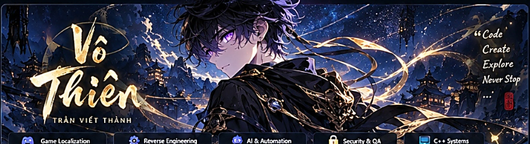
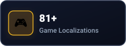
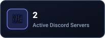
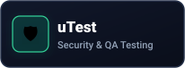
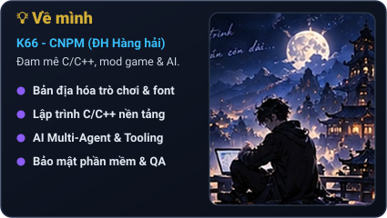
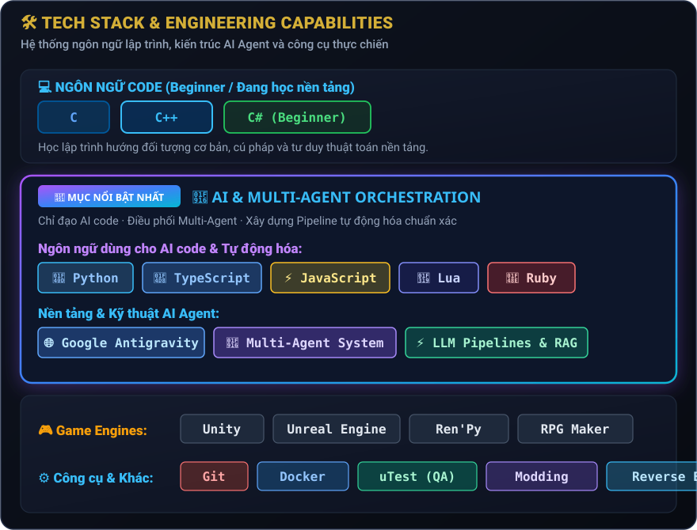
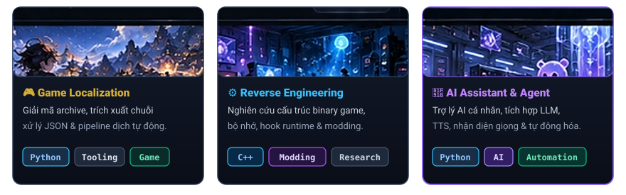
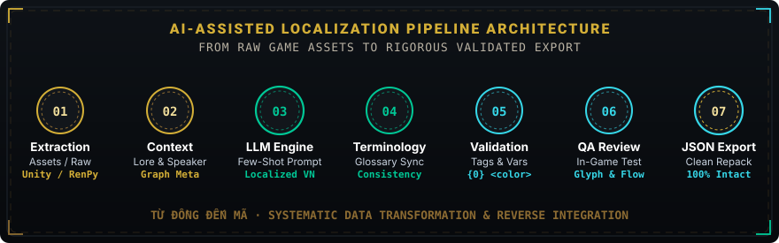
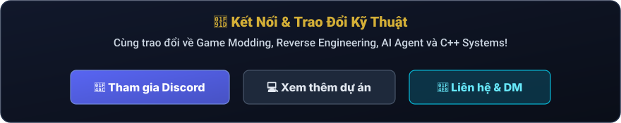
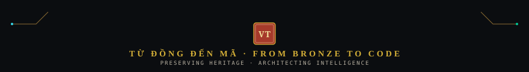

  <!-- ================================================================= -->
  <!-- HERO BANNER: VÔ THIÊN - TRẦN VIẾT THÀNH -->
  <!-- ================================================================= -->
  

    

  <!-- DYNAMIC TYPING STATUS -->
  

   

  <!-- QUICK ACTION PILLS -->
  

    
    
    
    
  

---

### 📊 Cột Mốc Thực Chiến — Verified Milestones

  <table border="0" style="border: none; background: transparent;">
    <tr style="background: transparent;">
      <td style="border: none; padding: 4px;"></td>
      <td style="border: none; padding: 4px;"></td>
      <td style="border: none; padding: 4px;"></td>
      <td style="border: none; padding: 4px;"></td>
    </tr>
  </table>

---

### 💡 Thông Tin Cá Nhân & GitHub Analytics

  <table border="0" style="border: none; background: transparent;">
    <tr style="background: transparent;">
      <!-- LEFT: ABOUT ME CARD -->
      <td align="center" style="border: none; padding: 6px; vertical-align: top;">
        
      </td>
      <!-- RIGHT: GITHUB STATS -->
      <td align="center" style="border: none; padding: 6px; vertical-align: top;">
        
      </td>
    </tr>
    <tr style="background: transparent;">
      <td align="center" style="border: none; padding: 6px; vertical-align: top;">
        
      </td>
      <td align="center" style="border: none; padding: 6px; vertical-align: top;">
        
      </td>
    </tr>
  </table>

---

### 🛠️ Kỹ Năng Kỹ Thuật & Kiến Trúc AI

  

---

### 🚀 Dự Án Nổi Bật — Featured Projects

  

---

### 🔄 Quy Trình 7 Bước: Pipeline Việt Hóa Game Bằng AI

  

---

### 🤝 Kết Nối & Trao Đổi Kỹ Thuật

  

 

  
  
<em>Từ đồng đến mã — giữ lửa, truyền nhịp.</em>

