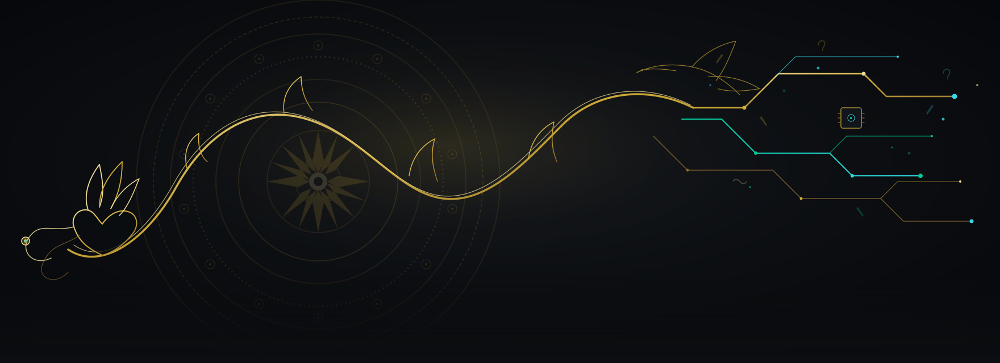
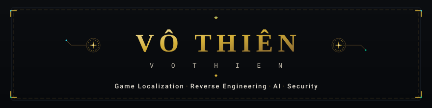
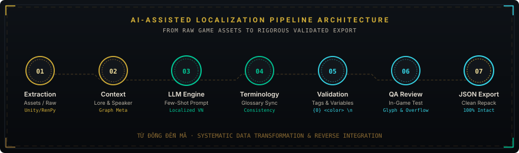
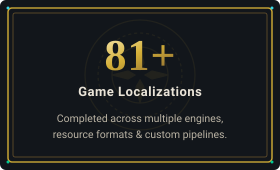
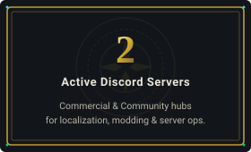
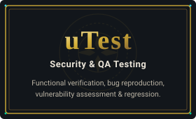
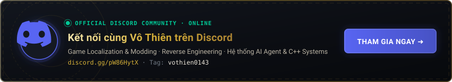

  <!-- ================================================================= -->
  <!-- HERO BANNER: Rồng Lý, Trống Đồng Đông Sơn, Mạch Điện Cybernetic -->
  <!-- ================================================================= -->
  

  <!-- WORDMARK PLATE -->
  

  <!-- DYNAMIC TYPING STATUS -->
  

  

    <strong>Đọc cấu trúc file cũ, dựng lại hệ thống mới.</strong> 
    <em>Tiếng trống đồng ngàn năm hòa cùng nhịp xung số, code C++ tối ưu và pipeline tự động hóa.</em>
  

  <!-- QUICK ACTION PILLS -->
  

    
    
    
    
  

---

### 🏛️ 4 Mảng Kỹ Thuật Trọng Tâm — Core Engineering Focus

| 🎮 **Game Localization & Reverse Engineering** | ⚡ **C++ Systems & Performance Engineering** |
| :--- | :--- |
| • Trích xuất, giải mã và đóng gói archive binary đa engine • Xử lý font SDF, TextMeshPro và glyph tiếng Việt có dấu • Giữ nguyên 100% control tag (`<color>`), regex và biến logic | • Lập trình C++20 chuẩn mực, bám sát C++ Core Guidelines • Quản lý tài nguyên chuẩn RAII, hạn chế tối đa rò rỉ bộ nhớ (zero-leak) • Phân tích điểm nghẽn hiệu năng, FPS profiling & Runtime Hooking |

| 🤖 **AI Engineering & Agent Orchestration** | 🛡️ **Software Security & QA Testing** |
| :--- | :--- |
| • Thiết kế hệ thống điều phối Multi-Agent (Google Antigravity) • Pipeline 7 bước bản địa hóa tự động với LLM & Schema chặt chẽ • Chuẩn hóa văn phong tự nhiên, loại bỏ hoàn toàn lối hành văn AI sáo rỗng | • Kiểm thử bảo mật ủy quyền, phát hiện lỗi logic hệ thống • Kiểm thử chất lượng phần mềm uTest (ghi nhận & cô lập bug thực tế) • Regression testing đảm bảo hệ thống chạy chuẩn sau vá lỗi |

---

### 🔄 Quy Trình 7 Bước: Pipeline Việt Hóa Game Tự Động Bằng AI

   Phân tích ngữ cảnh -> LLM Engine -> Thuật ngữ -> Kiểm chứng biến -> Thẩm định QA -> Xuất JSON" width="880">

---

### 📊 Cột Mốc Thực Chiến — Verified Milestones

  
  
  

---

### 💬 Giao Lưu & Kết Nối Cộng Đồng Discord

  

---

### 🛠️ Kỹ Năng & Công Cụ Sử Dụng — Tech Stack

| Phân hệ | Công nghệ & Công cụ |
| :--- | :--- |
| **Ngôn ngữ hệ thống** |    |
| **Kịch bản & Tự động hóa** |      |
| **Game Engines** |     |
| **AI & Môi trường Dev** |     |

---

### 📈 Hoạt Động GitHub — Analytics & Activity

  <table border="0" style="border: none; background: transparent;">
    <tr style="background: transparent;">
      <td align="center" style="border: none; padding: 5px;">
        
      </td>
      <td align="center" style="border: none; padding: 5px;">
        
      </td>
    </tr>
  </table>

   

  

---

### 🤝 Kết Nối & Trao Đổi Kỹ Thuật

* **Discord Server:** [discord.gg/pW86HytX](https://discord.gg/pW86HytX) *(Cộng đồng thảo luận Game Modding & AI Systems)*
* **Discord Username:** `vothien0143`
* **Website cá nhân:** [thanh116505-vothien.github.io](https://thanh116505-vothien.github.io/)
* **Định hướng trao đổi:** Game Localization · Modding Tooling · C++ Systems · Pipeline AI Agent · Kiểm thử phần mềm.

 

  
  
<em>Từ đồng đến mã — giữ lửa, truyền nhịp.</em>

