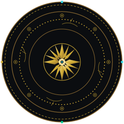

  <!-- HERO BANNER: Rồng Lý, Trống Đồng Đông Sơn, Mạch Điện (Tỷ lệ 11:4) -->
  

  <!-- WORDMARK PLATE: Tên VÔ THIÊN, Tiêu đề, Họa tiết Đông Sơn -->
  

  <!-- TYPING SVG: Nhịp xung tín hiệu số trên nền #0B0D10 -->
  

  

    Đọc ngôn ngữ cũ, dựng lại thành hệ thống mới. 
    Tiếng trống đồng từ nghìn năm trước hôm nay hòa vào từng xung nhịp trong mạch điện và kiến trúc tự động hóa.
  

  

    
    
    
  

##  Về Tôi — About Me

*Giải mã trước, dựng lại sau.*

Tôi là **Vô Thiên (VoThien)** — một kỹ sư phần mềm chuyên sâu vào giải mã cấu trúc dữ liệu game (**Game Localization & Reverse Engineering**), tối ưu hiệu năng (**Modding & Profiling**), vận hành hạ tầng máy chủ (**Server Architecture**) và thiết kế quy trình trí tuệ nhân tạo (**AI Engineering & Agent Orchestration**).

Mỗi định dạng nhị phân, mỗi tệp tài nguyên đóng gói hay mỗi mô hình ngôn ngữ đều chứa đựng những quy luật logic cần được khai phá. Cách tiếp cận của tôi là kết hợp sự chuẩn mực kỹ thuật có thể kiểm chứng với tư duy hệ thống mạch lạc, đảm bảo mọi sản phẩm từ mã nguồn đến bản địa hóa đều đạt độ hoàn thiện cao nhất.

##  Lĩnh Vực Chuyên Môn — Technical Domains

*Mỗi tệp tin là một ngôn ngữ chưa được đọc.*

###  1. Game Localization & Reverse Engineering
Chuyên sâu trích xuất, phân tích và tái cấu trúc tài nguyên game phục vụ Việt hóa chất lượng cao.

<b>Chi tiết kỹ thuật (Technical Scope)</b>

 

* **Asset Extraction & Repacking:** Khảo sát cấu trúc container, archive nhị phân độc quyền và định dạng đóng gói của nhiều game engine.
* **Data Structure & Script Parsing:** Xử lý và kiểm thử JSON, XML, byte-code script, đảm bảo không phá vỡ logic sự kiện.
* **Font Asset Modification & Glyph Mapping:** Chỉnh sửa texture font, SDF (Signed Distance Field), TextMeshPro asset; ánh xạ bảng mã tiếng Việt đầy đủ dấu thanh không chồng lấn.
* **Tag & Variable Preservation:** Giữ nguyên vẹn format tags (`<color>`, `<size>`), control codes và biến logic động (`{0}`, `%s`, `\n`) trong mọi câu thoại.

###  2. Game Modding & Performance Optimization
Can thiệp logic gameplay, viết script mở rộng và phân tích hiệu năng hệ thống.

<b>Chi tiết kỹ thuật (Technical Scope)</b>

 

* **Game Logic Modification:** Xây dựng plugin, hook runtime, can thiệp logic xử lý bằng script hoặc assembly patch.
* **Bottleneck Profiling:** Phân tích điểm nghẽn hiệu năng, đo đạc FPS profiling, kiểm tra rò rỉ bộ nhớ (memory-leak detection).
* **Render & Compatibility Debugging:** Đánh giá hành vi render đồ họa và gỡ lỗi xung đột tương thích trên nhiều môi trường thực thi.

###  3. Game Server Architecture
Thiết lập, vận hành và giám sát hạ tầng máy chủ trò chơi chuyên dụng.

<b>Chi tiết kỹ thuật (Technical Scope)</b>

 

* **Dedicated Server Deployment:** Cấu hình và bảo trì Dedicated Server đa dịch vụ với độ trễ thấp và băng thông ổn định.
* **Database & Monitoring:** Vận hành cơ sở dữ liệu lưu trữ tiến trình người chơi, sao lưu dự phòng tự động và giám sát tài nguyên CPU/RAM/Network.
* **Troubleshooting & Reliability:** Cô lập sự cố mạng, xử lý xung đột gói tin và đảm bảo tính sẵn sàng cao của hệ thống.

###  4. Security Research & QA Testing
Đánh giá lỗ hổng bảo mật được ủy quyền và kiểm thử chất lượng phần mềm toàn diện.

<b>Chi tiết kỹ thuật (Technical Scope)</b>

 

* **Vulnerability Assessment:** Rà soát bề mặt tấn công, phát hiện điểm yếu logic trong phạm vi được cấp quyền hợp pháp.
* **Software QA & Bug Reproduction:** Thực hiện kiểm thử chức năng trên nền tảng **uTest**, ghi nhận evidence rõ ràng, phân loại mức độ nghiêm trọng và viết quy trình tái hiện lỗi chuẩn xác.
* **Regression Testing:** Xác minh tính ổn định của các bản vá lỗi trước khi triển khai chính thức.

##  AI Engineering & Intelligent Automation

*Không chỉ ra lệnh cho mô hình — thiết kế cả quy trình quanh nó.*

AI trong công việc của tôi không phải là danh sách câu lệnh ngẫu hứng, mà là một **kiến trúc hệ thống hoàn chỉnh**. Tôi xây dựng các pipeline tự động hóa có kiểm soát, nơi mô hình ngôn ngữ lớn (LLM) phối hợp chặt chẽ với các bộ lọc quy tắc, thuật toán kiểm thử ngữ pháp và công cụ trích xuất dữ liệu để tạo ra đầu ra ổn định, an toàn và sẵn sàng đưa vào môi trường sản xuất.

   02 Context -> 03 LLM Engine -> 04 Terminology -> 05 Validation -> 06 QA Review -> 07 JSON Export" width="880">

*Quy trình 7 bước Từ Đồng Đến Mã: Trích xuất thô → Phân tích ngữ cảnh hội thoại → Chuyển ngữ có điều kiện → Đồng bộ thuật ngữ đa tệp → Kiểm chứng biến & placeholder → Thẩm định QA trong game → Xuất JSON nguyên vẹn.*

### 1. Advanced Prompt Architecture
* **Structured Output Constraints:** Ép buộc mô hình trả về đúng schema định dạng (JSON/YAML/Custom DSL) bằng cách thiết kế ngữ cảnh chặt chẽ và few-shot learning chính xác.
* **Prompt Chaining & Decomposition:** Phân rã tác vụ phức tạp thành chuỗi các bước độc lập, giảm thiểu hiện tượng ảo giác (hallucination) và nâng cao tính nhất quán.

### 2. AI Agent & Skill Development
* **Tool Use & MCP Integration:** Tích hợp Model Context Protocol (MCP), kết nối tác nhân thông minh với cơ sở dữ liệu, file system và GitHub API.
* **Task Routing & Error Handling:** Tự động điều phối tác vụ giữa các chuyên gia AI, tự động retry và fallback khi gặp phản hồi sai định dạng.

### 3. AI Humanization & Persona Naturalization
* **Tone & Register Adaptation:** Điều chỉnh giọng văn hội thoại tự nhiên, linh hoạt giữa phong cách cổ phong/kiếm hiệp, đời thường hay kỹ thuật số mà không vướng văn phong AI sáo rỗng.
* **Context-Aware Dialogue:** Giữ trọn danh xưng, cá tính nhân vật và nhịp điệu đàm thoại tương thích với bối cảnh văn hóa của tựa game.

### 4. Automated Verification & QA
* **Lossless Validation:** Xác thực tự động bảo toàn 100% key, thẻ nhúng, biến số và ký tự điều khiển trong file dịch trước khi đóng gói lại vào game engine.

##  Hệ Thống Công Cụ — Tech Stack

*Nền móng vững, công cụ tùy việc.*

### Nền tảng cốt lõi (Core Systems Programming)
`Systems Programming · Object-Oriented Design · Data Structures · Memory Management`

  
  
  

### Ngôn ngữ kịch bản & Hệ sinh thái Game Engine
`Asset Manipulation · Automation Tooling · Engine Hooking`

  
  
  
  
  

  
  
  
  

##  Cột Mốc & Cộng Đồng — Milestones & Community

*Những con số có thật, nói thay lời.*

  
  
  

* Dữ liệu minh bạch: Toàn bộ số liệu dựa trên các dự án và cộng đồng đã được xây dựng và triển khai thực tế.

##  Dấu Vết Hoạt Động — GitHub Analytics

*Dấu vết trên bảng mã.*

<!-- TODO: thay thanh116505-vothien bằng username GitHub chính thức của bạn -->

  
  

  

##  Kết Nối & Hợp Tác — Contact & Collaboration

*Có việc hay, cứ gõ cửa.*

Tôi luôn cởi mở trao đổi chuyên môn kỹ thuật, chia sẻ kinh nghiệm xử lý tài nguyên game và hợp tác xây dựng các giải pháp tự động hóa thông minh.

* **Discord:** `vothien0143`
* **Badge liên hệ:**

  

**Lĩnh vực hợp tác:** Game Localization · Modding & Tooling · AI Automation · Dịch vụ Kỹ thuật Máy chủ · QA Testing được ủy quyền.

  
  
<em>Từ đồng đến mã — giữ lửa, truyền nhịp.</em>

